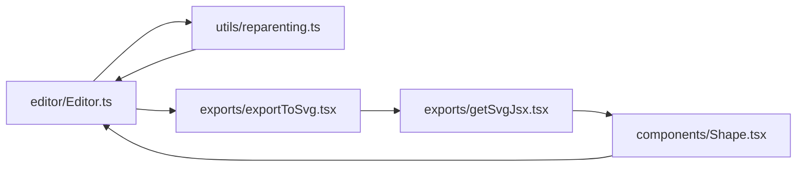

# Artefakt 2 — Struktura (graf zależności)

> Kopia mapy cudzego repo (tldraw/tldraw) do raportu 10xArchitect. Nazwiska zastąpiono rolami; liczby i ścieżki bez zmian.

Repo: `tldraw/tldraw`, HEAD `844f6f484`. Wejście: `artifact-1-territory.md`.
Narzędzie: dependency-cruiser 16.10.4 + TypeScript 5.9 (z osobnego folderu; repo używa TS 7, którego depcruise nie obsługuje). Zależności repo zainstalowane przez `pnpm install --frozen-lockfile --ignore-scripts`; **nic nie dopisano do `package.json` tldraw**, konfiguracja reguł poza repo.

| Skan | Zakres | Moduły | Zależności | Nierozwiązane |
|---|---|---|---|---|
| SDK | `packages/{editor,tldraw,store,tlschema,state,utils,validate}/src` | 1080 (675 prod, 399 test) | 4188 | 0 |
| tldraw.com | `apps/dotcom/{client,sync-worker}/src`, `packages/dotcom-shared/src` (+ śledzone pakiety SDK) | 1346 | — | tylko `cloudflare:workers` i assety Vite `?url` (runtime/bundler) |

„Runtime” = krawędzie bez importów typów (`type-only`, `pre-compilation-only`). Cykle liczone jako silnie spójne składowe (SCC) na kodzie produkcyjnym; „najmniejsza pętla” = najkrótszy cykl w składowej.

## Najważniejsze obserwacje

1. **Granice warstw SDK są czyste.** 0 naruszeń reguł: `editor` nie importuje `tldraw`, niższe warstwy (`utils/state/store/tlschema/validate`) nie importują w górę, `src/lib` nie importuje `src/test`, pakiety nie importują aplikacji. 0 importów omijających `src/index.ts` innego pakietu.
2. **`packages/editor/src/index.ts` jest faktycznym kontraktem SDK**: fan-in 491. `tldraw` sięga do niższych warstw prawie wyłącznie przez `editor` (293 krawędzie do `editor`, 4 bezpośrednio do `store/state/tlschema`). Zmiana eksportu w `editor` = zmiana dla całego SDK.
3. **9 cykli runtime w SDK, ale jeden dominuje**: `tldraw/src/lib/ui` — 58 plików. Najmniejsza pętla: `ui/components/Toolbar/DefaultToolbar.tsx ↔ ui/context/components.tsx` (rejestr komponentów UI).
4. **CI tego cyklu nie widzi z założenia.** `internal/scripts/check-circular-deps.ts` (job `checks.yml`) skanuje `ui/components` i `ui/context` w **osobnych partiach**, bo `vite-plugin-circular-dependency` wywraca się na nich razem („Invalid array length”). Cykl łączący te dwa foldery jest więc poza zasięgiem kontroli.

   Dowód (HEAD `844f6f484`):
   - CI: `.github/workflows/checks.yml:53` → `run: pnpm check-circular-deps`; skrypt w `package.json:61` → `tsx internal/scripts/check-circular-deps.ts`.
   - Powód podziału: `internal/scripts/check-circular-deps.ts:38` — komentarz `` `vite-plugin-circular-dependency` crashes with "Invalid array length" on tldraw when `ui/components` and `ui/context` are scanned together ``.
   - Podział: `internal/scripts/check-circular-deps.ts:82` i `:84` przypisują `ui/components` i `ui/context` do osobnych wzorców; `:91–94` buduje `includePatternSets`, w którym każdy z nich jest **osobną partią** (`[index.ts, uiComponentsPattern]`, `[index.ts, uiContextPattern]`).
   - Cykl przecinający partie: `DefaultToolbar.tsx` (w `ui/components`) ↔ `ui/context/components.tsx` — z SCC w skanie depcruise.
   - Komendy potwierdzające:
     ```sh
     grep -n "check-circular-deps" .github/workflows/checks.yml package.json
     grep -n "Invalid array length\|uiComponentsPattern\|uiContextPattern\|includePatternSets = \[" internal/scripts/check-circular-deps.ts
     ```
   - Ostatnia zmiana skryptu: `55e32edf7` (2026-09-30, „build: replace lazyrepo with turbo”).
   - Czego nie sprawdzono: nie uruchamiano `pnpm check-circular-deps` (zależności zainstalowane z `--ignore-scripts`, bez buildu). Teza opiera się na kodzie skryptu + grafie depcruise.
5. **tldraw.com ma czystą granicę klient ↔ backend**: `client` i `sync-worker` nie importują się nawzajem; łączą je `dotcom-shared` (39 / 47 krawędzi, fan-in `index.ts` = 100) i `sync-core` (7 / 28).

## Cykle w aktywnych obszarach

| Obszar | Co znalazłeś | Dowód z dependency-cruiser | Dlaczego to ważne przy zmianie | Związek z `artifact-1-territory.md` | Co sprawdzić dalej |
|---|---|---|---|---|---|
| UI SDK (`tldraw/src/lib/ui`) | SCC 58 plików, runtime | `DefaultToolbar.tsx → ui/context/components.tsx → DefaultToolbar.tsx` | Rejestr domyślnych komponentów importuje komponenty, a komponenty importują rejestr. Zmiana jednego komponentu może zmienić kolejność inicjalizacji całego UI. Niewidoczne dla CI (pkt 4). | `tldraw/src/lib/ui`: 207 commitów, 88 `fix` | Czy rejestr da się odwrócić (komponenty nie importują `components.tsx`)? Czy CI może sprawdzać tę parę inaczej? |
| Schemat (`tlschema/src`) | SCC 33 pliki, runtime | `TLVideoShape.ts → records/TLShape.ts → TLVideoShape.ts` | `TLShape.ts` to unia wszystkich kształtów; każdy kształt importuje unię. **Rejestr z założenia**, nie błąd granic. Dodanie kształtu dotyka unii, `createTLSchema` i migracji. | `tldraw + tlschema` zmieniają się razem w 45% | Które importy są realnie runtime (walidatory, migracje), a które tylko typami bez `import type`? |
| Silnik (`editor/src/lib`) | SCC 5 plików, runtime | `Editor.ts → utils/reparenting.ts → Editor.ts`; `Editor.ts → exports/exportToSvg.tsx → getSvgJsx.tsx → components/Shape.tsx → Editor.ts` | `Editor.ts` (128 commitów, 78 `fix`) jest w pętli z eksportem SVG i reparentingiem. Z importami typów pętla rośnie do 30 plików (wszystkie managery: `ClickManager`, `SnapManager`, `FontManager`…). | Plik nr 1 w historii | Pętla z managerami to wsteczne referencje typów (`editor: Editor`) — wzorzec, nie problem. Runtime: `reparenting` i `exportToSvg` — kandydaci na Deep Focus. |
| Strzałki (`tldraw/src/lib/shapes/arrow` + `bindings`) | SCC 8 plików, runtime | `arrow/arrowTargetState.ts → ArrowShapeUtil.tsx → arrowTargetState.ts` | Kształt strzałki i jej powiązania (bindings) są splątane; `fix(arrows)` 19× w roku. | `shapes`: 167 commitów, 99 `fix` | Zasięg zmiany w `ArrowShapeUtil`: runtime reach 363 moduły. |
| Store (`store/src/lib`) | SCC 9 plików | `StoreSideEffects.ts → Store.ts → StoreSideEffects.ts` | Mały, stabilny rdzeń; cykl zamknięty w jednym pakiecie. | `store`: 42 commity, skok w 26Q3 | Niski priorytet. |
| Worker (`apps/dotcom/sync-worker/src`) | SCC 16 plików, runtime | `utils/featureFlags.ts → utils/tla/getAuth.ts → featureFlags.ts`; w składowej `TLFileDurableObject.ts`, `postgres.ts`, `routes/` | Flagi funkcji i autoryzacja są splątane z zapisem plików. Zmiana flag może dotknąć logowania i Durable Object. | worker: skok do 103 commitów w 26Q3 | Runtime coupling przez flagi — graf statyczny nie pokaże, które flagi są aktywne. |
| Klient (`apps/dotcom/client/src`) | SCC 9 plików | `tla/hooks/useSignUpTracking.ts → utils/analytics.tsx → useSignUpTracking.ts` | Analityka splątana z rejestracją. | `client/src/tla`: 261 commitów | Niski priorytet (peryferia). |
| Mniejsze | `LaserTool ↔ Lasering`, `state/Atom ↔ transactions`, `OverlayUtil ↔ event-types`, `copyAs ↔ clipboard` | SCC 2–3 pliki | Lokalne, typowe dla maszyn stanów i reaktywności. | — | Pominąć. |

## Granice warstw

| Sprawdzana granica | Wynik | Dowód | Dlaczego to ważne przy zmianie | Związek z terytorium | Co sprawdzić dalej |
|---|---|---|---|---|---|
| `utils → state → store → tlschema → editor → tldraw` (deklarowane w `package.json`) | **Zachowana** | reguły `lower-layers-not-up`, `editor-not-to-tldraw`: 0 naruszeń | Kierunek przewidywalny; zmiana w `tldraw` nie cofa się do silnika. | `editor + tldraw` 56% współzmian — ale to zmiany **w dół** (SDK nadąża za silnikiem) | — |
| Import przez publiczny `index.ts` | **Zachowany** | reguła `deep-import-into-other-package`: 0 | Publiczne API = `index.ts` + `api-report.api.md` (generowany, pilnowany przez `api-check`). | `editor/src/index.ts` 38 commitów, `tldraw/src/index.ts` 40 | — |
| Kod produkcyjny nie importuje testów | **Zachowana** | `lib-not-to-test`: 0 | — | — | — |
| `dotcom-shared` jako kontrakt klient ↔ worker | **Zachowana** | brak krawędzi `client ↔ sync-worker`; `dotcom-shared → tldraw` tylko `type-only` (`types.ts`) | Kontrakt jest czysty; zmiana typów w `dotcom-shared` trafia w obie strony naraz. | 88% współzmian `dotcom + dotcom-shared` | Czy schemat Postgres/Zero w workerze i `dotcom-shared` są zsynchronizowane (niewidoczne w grafie). |
| Aplikacja importuje inną aplikację | Fałszywy alarm | `client/src/pages/dev-browser-run-thumbnail.tsx → apps/examples/.../snapshot.json` | Strona deweloperska z fixture'ami JSON. | — | — |

## Metryki (fan-in / Ca / instability)

| Moduł | Sygnał | Odczyt |
|---|---|---|
| `editor/src/index.ts` | fan-in 491 | kontrakt SDK, wysoka wrażliwość |
| `utils/src/index.ts` | fan-in 127 (SDK) / 174 (z dotcom), Ca 58, I 0.36 | fundament, wiele zależnych |
| `validate/src/index.ts` | Ca 50, Ce 2, **I 0.04** | stabilny kontrakt walidacji |
| `tlschema/src/index.ts` | Ca 11, **Ce 62, I 0.85** | agregator schematu — zależy od wszystkich rekordów |
| `tlschema/src/records/TLShape.ts` | Ca 25, Ce 21 | węzeł unii kształtów — środek grafu |
| `editor/editor/Editor.ts` | fan-in 67, runtime reach 248 | hub silnika |
| `tldraw/ui/hooks/useTranslation` | fan-in 69 | i18n w każdym komponencie UI (kampania ICU 26Q4) |
| `dotcom-shared/src/index.ts` | fan-in 100, I 0.35 | kontrakt tldraw.com |
| `sync-worker/src/types.ts` | fan-in 91 | wspólne typy workera |
| `sync-worker/src/TLFileDurableObject.ts` | Ce 25, I 0.89 | orkiestrator — zależy od wielu, mało kto od niego |

## Ryzyka testowe

### Podsumowanie

Testy SDK są **z założenia integracyjne**: 242 pliki testów w `packages/tldraw`, 62 w `packages/editor`. `TestEditor` (`packages/tldraw/src/test/TestEditor.ts`) tworzy pełny edytor z kształtami i narzędziami — dlatego 47% commitów `editor/src/lib` rusza `tldraw/src/test` (artefakt 1). Mockowanie pojedynczych managerów ma mały sens; zasięg runtime jest zbyt duży.

### Lista ryzyk testowych

| Miejsce | Runtime reach | Ryzyko | Właściwy poziom testu |
|---|---|---|---|
| `tldraw/src/lib/Tldraw.tsx` | 650 modułów | pełne SDK + UI | e2e (`apps/examples/e2e`) |
| `tldraw/src/lib/ui/*` (cykl 58) | ~507 na plik | każdy komponent UI ciągnie cały kontekst UI | test komponentu z pełnym providerem albo e2e |
| `tools/SelectTool/SelectTool.ts` | 403 | maszyna stanów, `fix(select)` 35× | integracyjny przez `TestEditor` (już tak jest) |
| `shapes/arrow/ArrowShapeUtil.tsx` | 363 | cykl z bindings | integracyjny przez `TestEditor` |
| `editor/editor/Editor.ts` | 248 | hub + cykl z SVG export | integracyjny; jednostkowo tylko czyste funkcje (`primitives/`) |
| `client/src/tla/components/TlaEditor/TlaEditor.tsx` | 921 | edytor + konto + sync | e2e (`apps/dotcom/client/e2e`, 19 specyfikacji) |
| `client/src/tla/app/TldrawApp.ts` | 725 | stan aplikacji tldraw.com | integracyjny z mockiem Zero/sync — **do sprawdzenia** |
| `sync-worker/src/TLFileDurableObject.ts` | 226 | Durable Object + Postgres + flagi | integracyjny (62 testy workera); `cloudflare:workers` poza grafem |

### Najbardziej podejrzane moduły

- `tldraw/src/lib/ui/context/components.tsx` — serce cyklu 58 plików, poza zasięgiem CI.
- `editor/src/lib/editor/Editor.ts` — hub z pętlą runtime przez `exportToSvg` i `reparenting`.
- `apps/dotcom/sync-worker/src/utils/featureFlags.ts` + `utils/tla/getAuth.ts` — flagi splątane z autoryzacją.

### Co sprawdzić dalej

- Dlaczego CI (`check-circular-deps`) nie zgłasza cykli w `tlschema` i `store` — inny model grafu (bundler po eliminacji importów typów)? **needs verification**.
- Czy `TldrawApp.ts` ma testy bez pełnego klienta.

### Opcjonalny kolejny krok: graf

Graphviz nie jest zainstalowany, więc zamiast SVG — Mermaid dla jednego pytania: **co tworzy pętlę runtime wokół `Editor.ts`?**



## Niewiadome

- **Runtime coupling poza grafem**: flagi funkcji (worker), Durable Objects i `cloudflare:workers`, Zero/Postgres, rejestry kształtów/narzędzi przekazywane przez propsy (`shapeUtils`, `tools`), dynamiczne importy.
- **Nie skanowano**: `apps/examples`, `apps/docs`, `apps/mcp-app`, `packages/sync*` poza tym, co było śledzone z dotcom, `internal/scripts`. Brak grafu dla nich = `unknown`, nie „brak powiązań”.
- Cykle `tlschema`/`store` mogą być importami używanymi wyłącznie jako typy bez `import type` — depcruise oznacza je jako `pre-compilation-only` tylko, gdy TS je elimuje; do weryfikacji.
- Zgodność wersji: analiza na TS 5.9, repo kompiluje TS 7 — drobne różnice w rozwiązywaniu modułów możliwe.

## Wnioski dla mapy

- SDK ma **zdrową architekturę warstw** i **jeden duży dług**: cykl w UI, którego CI nie łapie.
- Ryzyko zmiany koncentruje się w trzech węzłach: `editor/src/index.ts` (kontrakt), `Editor.ts` (hub), `ui/context/components.tsx` (rejestr UI).
- tldraw.com: granica klient/worker czysta, ryzyko w workerze (flagi + autoryzacja + Durable Object).
