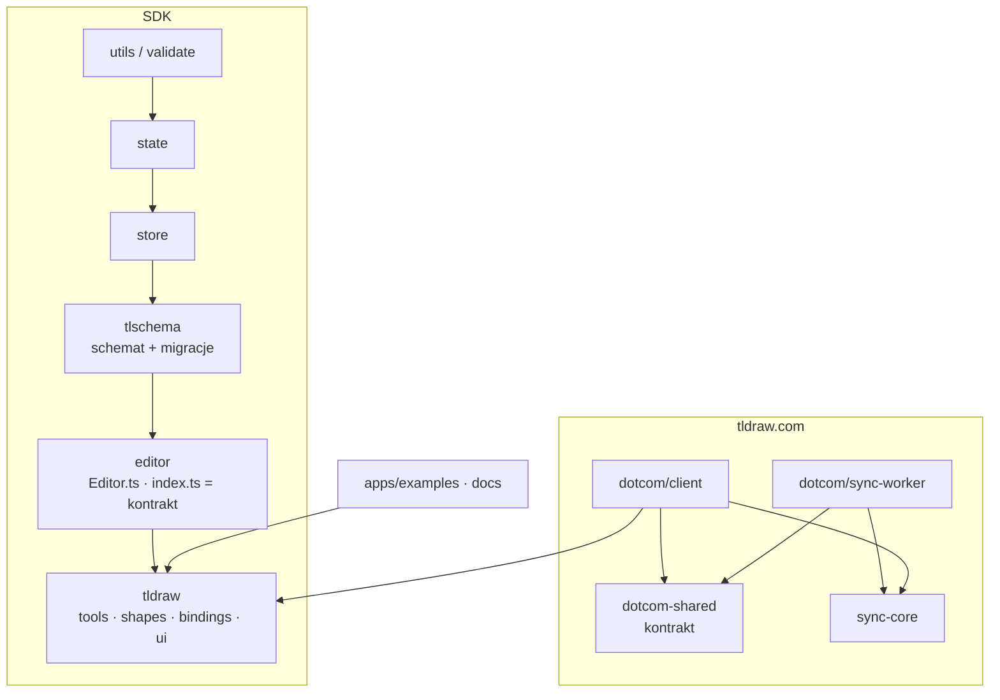

# Mapa projektu — tldraw/tldraw

- **Źródło:** [tldraw/tldraw](https://github.com/tldraw/tldraw) @ `844f6f484` ([commit](https://github.com/tldraw/tldraw/commit/844f6f484))
- **Data analizy:** 2026-11-05 (okno historii 2025-11-05 → 2026-11-05)
- **Autor analizy:** Szymon Budrewicz, z agentem Claude Code (ćwiczenie M4L2, 10xDevs)

HEAD `844f6f484` (2026-11-05). Synteza z `artifact-1-territory.md` (historia gita), `artifact-2-structure.md` (graf zależności), `artifact-3-contributors.md` (współtwórcy). Okno: 12 miesięcy.

> Kopia mapy cudzego repo (tldraw/tldraw) do raportu 10xArchitect. Nazwiska zastąpiono rolami; liczby i ścieżki bez zmian.

## 1. TL;DR

tldraw to monorepo z **dwoma produktami**: SDK tablicy (`packages/editor` — silnik, `packages/tldraw` — kształty, narzędzia, UI) oraz aplikacją **tldraw.com** (`apps/dotcom`: klient React + backend na Cloudflare Durable Objects, połączone kontraktem `packages/dotcom-shared`). Warstwy SDK są czyste: zero importów w górę i zero obejść publicznego `index.ts`. Praca skupia się w trzech miejscach: interakcje na płótnie (narzędzia i kształty, 60–66% commitów to poprawki), silnik z `Editor.ts` (plik nr 1: 128 commitów) i backend tldraw.com (skok w 26Q3). Boli: przypadki brzegowe interakcji z wiedzą u jednej osoby, cykl 58 plików w UI, którego test CI nie może wykryć, oraz flagi funkcji splątane z autoryzacją w workerze.

Strzałka = „importuje” (z grafu depcruise). `client` i `worker` nie importują się nawzajem.

## 2. Teren

| Moduł | Rola | Głęboki / płytki | Profil zmian (12 mies.) |
|---|---|---|---|
| `packages/tldraw/src/lib/{tools,shapes,bindings}` | **core** — zachowanie płótna | głęboki: maszyny stanów, geometria | rosnący do 26Q3; 60–66% `fix` |
| `packages/editor/src/lib/editor` | **core** — silnik, kamera, historia, zaznaczenie | głęboki; `Editor.ts` = hub | rosnący, skok w 26Q3 |
| `packages/tldraw/src/lib/ui` | supporting — UI SDK | szeroki, płytki per komponent, splątany rejestrem | stały, kampania i18n 26Q4 |
| `apps/dotcom/client/src/tla` | **core** tldraw.com — konta, pliki | `TldrawApp.ts` głęboki, strony płytkie | **stały**, najwyższy poziom bazowy |
| `apps/dotcom/sync-worker/src` | **core** tldraw.com — zapis, sync, auth | `TLFileDurableObject.ts` = orkiestrator (I 0.89) | **sezonowy**: 103 commity w 26Q3 |
| `packages/dotcom-shared` | kontrakt klient ↔ worker | płytki, nośny (fan-in 100) | zmienia się prawie tylko razem z `dotcom` |
| `packages/tlschema` | kontrakt danych dokumentu | rejestr kształtów + migracje | stabilny, mało pracy od sierpnia |
| `packages/{utils,state,store,validate}` | fundament | stabilne (`validate` I 0.04) | niska aktywność |
| `apps/docs`, `apps/examples`, `internal/scripts`, `.github` | peryferia: dokumentacja, przykłady, deploy, CI | płytkie | wysokie liczby, niski koszt zmiany |

**Gdzie katalogi wprowadzają w błąd:**
- Testy silnika leżą w `packages/tldraw/src/test`, nie w `packages/editor`. 47% commitów `editor/src/lib` rusza `tldraw/src/test`, a `TestEditor` tworzy pełne SDK.
- `packages/fairy-shared` ma dużą aktywność w historii, ale został **usunięty** (`46ff8124b`, 2026-02-05).
- `packages/dotcom-shared` wygląda na wspólny pakiet, a w praktyce jest częścią aplikacji tldraw.com: 88% jego commitów dotyka też `apps/dotcom`.

## 3. Realne powiązania

| Powiązanie | Siła | Źródło wiedzy | Rodzaj |
|---|---|---|---|
| `editor` → `tldraw` | 56% współzmian; 293 krawędzie importów | git + graf | ręczna edycja; zmiany idą w dół warstw |
| `editor/src/index.ts` jako kontrakt SDK | fan-in 491 | graf | publiczne API; zmiana widoczna w `api-report.api.md` |
| `dotcom` ↔ `dotcom-shared` | 88% współzmian; fan-in 100 | git + graf | kontrakt ręczny |
| `client` ↔ `sync-worker` | 36% współzmian; **0** importów bezpośrednich | git + graf | funkcje pełnostosowe przez kontrakt |
| `tldraw` ↔ `tlschema` | 45% współzmian | git + graf | nowa właściwość = schemat + migracja |
| `dotcom-shared` ↔ schemat Postgres/Zero w workerze | — | **unknown**: graf tego nie widzi | runtime |
| `api-report.api.md` ↔ 34–36 obszarów | 89–99 commitów | git | **regeneracja** (`build-api`, pilnowane przez `api-check`) — tanie |
| `locales/en.json` → `locales-compiled/en.json` | 60/60 | git | źródło ręczne, wynik **generowany** (`build-i18n`) |

Cykle runtime (bez importów typów):

| Cykl | Rozmiar | Najmniejsza pętla | Waga |
|---|---|---|---|
| UI SDK | 58 | `ui/components/Toolbar/DefaultToolbar.tsx ↔ ui/context/components.tsx` | **wysoka**: niewidoczny dla CI |
| Schemat | 33 | `shapes/TLVideoShape.ts ↔ records/TLShape.ts` | rejestr z założenia (unia kształtów) |
| Sync worker | 16 | `utils/featureFlags.ts ↔ utils/tla/getAuth.ts` | **wysoka**: flagi + auth + zapis |
| Store | 9 | `StoreSideEffects.ts ↔ Store.ts` | niska, zamknięty w pakiecie |
| Strzałki | 8 | `arrow/arrowTargetState.ts ↔ ArrowShapeUtil.tsx` | średnia |
| Silnik | 5 | `Editor.ts → exportToSvg → getSvgJsx → Shape.tsx → Editor.ts`; `Editor.ts ↔ reparenting.ts` | średnia |

Bez grafu (`unknown`, a nie „brak powiązań”): `apps/examples`, `apps/docs`, `apps/mcp-app`, `internal/scripts`, flagi funkcji w czasie działania, Durable Objects, Zero/Postgres.

## 4. Strefy ryzyka

| # | Strefa | Gdzie w kodzie | Dlaczego (niezależne sygnały) |
|---|---|---|---|
| 1 | **Zaznaczanie, przekształcanie i rysowanie kształtów** | `packages/tldraw/src/lib/tools/SelectTool/`, `shapes/`, `shapes/arrow/`, `bindings/` | 60–66% `fix`, `fix(select)` 35× (git) · cykl strzałek, `SelectTool` ciągnie 403 moduły (graf) · bus factor 1 (ludzie) |
| 2 | **Silnik edytora i publiczne API SDK** | `packages/editor/src/lib/editor/Editor.ts`, `packages/editor/src/index.ts` | `Editor.ts` 128 commitów, 78 `fix` (git) · fan-in 491 na kontrakt, pętla runtime z eksportem SVG (graf) · bus factor 1 (ludzie) |
| 3 | **Interfejs SDK: menu, paski narzędzi, dialogi** | `packages/tldraw/src/lib/ui/context/components.tsx` i `ui/components/` | cykl 58 plików (graf) · test CI dzieli te foldery na osobne partie, więc go nie widzi (`internal/scripts/check-circular-deps.ts:82–94`) · 207 commitów, 88 `fix` (git) |
| 4 | **Zapis i synchronizacja plików w tldraw.com** | `apps/dotcom/sync-worker/src/TLFileDurableObject.ts`, `utils/featureFlags.ts`, `utils/tla/getAuth.ts`, `postgres.ts` | skok do 103 commitów w 26Q3 (git) · cykl flagi ↔ autoryzacja ↔ zapis, orkiestrator I 0.89 (graf) · część wiedzy u osoby nieaktywnej od kwietnia (ludzie) |
| 5 | **Kontrakt danych klient ↔ backend tldraw.com** | `packages/dotcom-shared/src/types.ts`, `mutators.ts` | 88% współzmian (git) · fan-in 100, oba końce zależą naraz (graf) · zgodność ze schematem Zero/Postgres = `unknown` |
| 6 | **Format dokumentu i migracje** | `packages/tlschema/src/createTLSchema.ts`, `store-migrations.ts`, `records/TLShape.ts` | 45% współzmian z `tldraw` (git) · „zimna” wiedza: 1–3 commity liderów w ostatnim kwartale (ludzie) · migracje danych użytkowników są nieodwracalne |

### Wygląda groźnie, ale nie jest

- **CI i deploy** (`.github/workflows`, `internal/scripts/deploy-dotcom.ts`): 26–36% `fix`, ale to poprawianie metodą prób i błędów, czyli zwykły tryb pracy.
- **`api-report.api.md`** zmienia się z 35 obszarami: plik generowany, sprawdzany w CI. Jeden sygnał o zmianie publicznego API (liczony w strefie 2), a nie osobne ryzyko.
- **`locales-compiled/en.json`** (63 commity): generowany z `locales/en.json`.
- **Cykl `Editor.ts` z 30 managerami**: same importy typów (`editor: Editor`). To celowy wzorzec; w czasie działania pętla ma 5 plików.
- **Cykl 33 plików w `tlschema`**: rejestr unii kształtów z założenia. Liczony raz, w strefie 6, i to nie jako główny sygnał.
- **`dotcom-shared → tldraw`**: import wyłącznie typu.
- **`client → apps/examples`**: strona deweloperska z przykładowymi snapshotami JSON.
- **`store/SPEC.md` + `store/src/lib`** (100% współzmian): konwencja utrzymywania specyfikacji razem z kodem.
- **`yarn.lock`, `packages/fairy-shared`**: usunięte, nie opierać na nich wniosków.
- **≥ 500 PR-ów zamkniętych bez merge, w tym 83 `releases`**: prawdopodobnie automatyzacja wydań (`unknown`).

## 5. Kogo zapytać

| Strefa | Kandydaci | Uwagi |
|---|---|---|
| 1. Kształty i narzędzia | **lider projektu** (55%, aktywny); przy strzałkach **kontrybutor kształtów (strzałki)** | bus factor 1 |
| 2. Silnik i API | **lider projektu** (53%); wydajność: **maintainer backendu A** | testy i spike'i: kontrybutor silnika (testy) |
| 3. UI SDK | **maintainer UI i i18n** (i18n, UI); **lider projektu** | |
| 4. Zapis i sync tldraw.com | **maintainer backendu A**, **maintainer backendu B** (bieżąca kampania) | były maintainer backendu nieaktywny od 2026-04 → czytać jego PR-y. Bieżąca kampania: uzasadnienia decyzji są w opisach PR |
| 5. Kontrakt `dotcom-shared` | **maintainer backendu A** (schemat Zero) | |
| 6. Schemat i migracje | **lider projektu**, **maintainer UI i i18n** | mało bieżącej aktywności |

Repo nie ma pliku `CODEOWNERS`, więc kandydaci pochodzą z historii commitów, a nie z formalnej własności.

## 6. Pierwszy dzień

1. `CONTRIBUTING.md` i `AGENTS.md`: konwencje repo (commity `typ(scope)`, workflow).
2. `packages/editor/src/index.ts`: co jest publicznym kontraktem SDK.
3. `packages/editor/src/lib/editor/Editor.ts`: hub silnika; czytaj wybiórczo, od konstruktora i managerów.
4. `packages/editor/src/lib/editor/tools/StateNode.ts`: baza maszyn stanów, na których stoją wszystkie narzędzia.
5. `packages/tldraw/src/lib/tools/SelectTool/SelectTool.ts`: najbardziej kruche narzędzie (strefa 1).
6. `packages/tldraw/src/test/TestEditor.ts`: jak testuje się SDK (integracyjnie).
7. `packages/tldraw/src/lib/ui/context/components.tsx`: rejestr UI i źródło cyklu (strefa 3).
8. Dla tldraw.com: `packages/dotcom-shared/src/index.ts`, potem `apps/dotcom/sync-worker/src/TLFileDurableObject.ts`.

## 7. Ograniczenia

- **Okno 1 roku** (2025-11-05 → 2026-11-05); starsze decyzje są niewidoczne.
- **Zmiany nazw nie są łączone** (klon `blob:none`, `--no-renames`). Reorganizacja `apps/examples` liczy się podwójnie.
- **Graf statyczny tylko dla SDK i tldraw.com**, analizowany przez TS 5.9 (repo używa TS 7). Nie pokazuje flag funkcji, Durable Objects, Zero/Postgres, dynamicznych importów ani rejestrów przekazywanych przez propsy.
- **Udział `fix`** liczony po prefiksie commita; to zależy od dyscypliny konwencji.
- **Współtwórcy = autorzy commitów.** Recenzenci PR i formalni właściciele nie są uwzględnieni.
- Test `pnpm check-circular-deps` **nie był uruchamiany**; wniosek o jego ślepej plamie pochodzi z kodu skryptu i grafu.
- Mapa mówi, **gdzie** uważać, a nie **dlaczego** kod tak wygląda. To zadanie dla Deep Focus.

## 8. Kandydaci do Deep Focus (M4L3)

| Przepływ | Zakres | Uzasadnienie z artefaktów | Co da się zweryfikować lokalnie |
|---|---|---|---|
| **A. Zaznaczenie i przesunięcie kształtu (z grupami i strzałkami)** | `SelectTool` i jego stany potomne → `Editor.ts` (zaznaczenie, historia, `reparenting.ts`) → `shapes/arrow` + `bindings` | strefy 1 i 2: 60–66% `fix`, `fix(select)` 35×, ostatnio seria poprawek dla grup i zablokowanych kształtów (A1, A3); cykle strzałek i `Editor ↔ reparenting`, zasięg 403 modułów (A2); bus factor 1 (A3) | tak: `TestEditor` i testy w `packages/tldraw/src/test`, bez infrastruktury |
| **B. Zapis zmiany pliku w tldraw.com** | `client/src/tla/app/TldrawApp.ts` → `dotcom-shared/src/mutators.ts` → `sync-worker/src/worker.ts` → `TLFileDurableObject.ts` → `postgres.ts` | strefy 4 i 5: kampania 26Q3 (A1); jedyny przepływ przez klienta, kontrakt i backend, cykl flagi ↔ auth (A2); wiedza rozproszona, ale częściowo historyczna (A3) | częściowo: duży udział `unknown` (Durable Objects, Zero, Postgres); pełna weryfikacja wymaga lokalnej infrastruktury dotcom |
| **C. Złożenie domyślnego UI z rejestru komponentów** | `ui/context/components.tsx` ↔ `ui/components/*` → `TldrawUi.tsx` | strefa 3: cykl 58 plików niewidoczny dla CI (A2); 207 commitów (A1) | tak, ale to bardziej kandydat do refaktoryzacji (M4L4) niż przepływ do śledzenia |

**Rekomendacja: przepływ A.** Ma najwięcej niezależnych sygnałów: historia, graf i ludzie wskazują to samo miejsce. Da się go w pełni prześledzić i zweryfikować lokalnie przez `TestEditor`, bez infrastruktury tldraw.com. Daje też naturalne wejście do kolejnych lekcji: bezpieczną refaktoryzację z gotowymi testami charakteryzacyjnymi w M4L4 (zespół robi już podobne `refactor(select): remove dead state…`) i bogaty język domeny w M4L5 (kształt, grupa, wiązanie, blokada, rodzic). Przepływ B warto wybrać, jeśli celem jest analiza pełnostosowa. Trzeba wtedy przyjąć, że sporo wniosków zostanie `unknown`.
