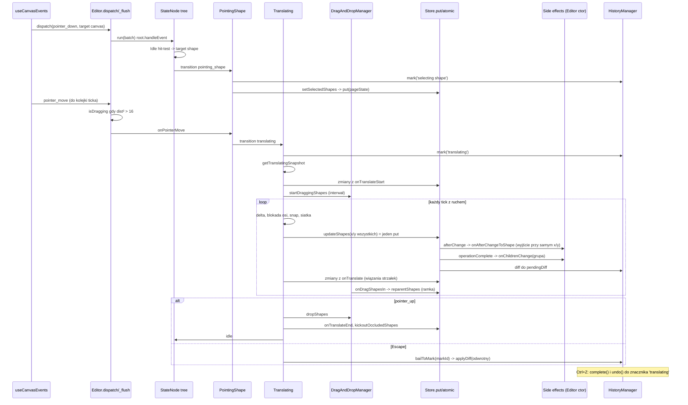

# Research: zaznaczenie i przesunięcie kształtu w tldraw

**Date**: 2026-11-10T10:25:05+01:00
**Git Commit**: `844f6f484`
**Repository**: tldraw/tldraw
**Prior**: `context/map/repo-map.md` (strefy ryzyka 1 i 2, kandydat A z sekcji 8)

Oznaczenia: **[E]** dowód (kod `file:line` lub wynik polecenia), **[I]** interpretacja, **[U]** biała plama.
Skróty ścieżek (względem `packages/`):
`ST` = `tldraw/src/lib/tools/SelectTool/`, `TR` = `ST/childStates/Translating.ts`, `PS` = `ST/childStates/PointingShape.ts`,
`E` = `editor/src/lib/editor/Editor.ts`, `SN` = `editor/src/lib/editor/tools/StateNode.ts`,
`HM` = `editor/src/lib/editor/managers/HistoryManager/HistoryManager.ts`, `S` = `store/src/lib/Store.ts`,
`ABU` = `tldraw/src/lib/bindings/arrow/ArrowBindingUtil.ts`, `ASU` = `tldraw/src/lib/shapes/arrow/ArrowShapeUtil.tsx`,
`DnD` = `ST/DragAndDropManager.ts`, testy = `tldraw/src/test/`.

## Research Question

Jak naprawdę działa przepływ „kliknij kształt i przeciągnij go” (także wewnątrz grupy, z podpiętymi strzałkami i ramkami), od zdarzenia DOM do zapisu w store i z powrotem? Gdzie są luki w testach i co musi zmienić się razem przy zmianie tego przepływu? Tylko stan obecny, bez propozycji refaktoru.

## Summary

- **Struktura folderów kłamie.** `SelectTool.ts` to tylko lista stanów potomnych (`ST/SelectTool.ts:22-49`), `StateNode` to ok. 15 linii routingu (`SN:169-181`), `select()` to alias `setSelectedShapes` (`E:2223-2227`). Cała orkiestracja przesunięcia siedzi w jednym pliku, `TR` (679 linii), a pozycje liczy jedna metoda `moveShapesToPoint` (`TR:565-679`). [E]
- **Folder `bindings/arrow` nie robi tego, na co wygląda.** Przy samym przesunięciu `onAfterChangeToShape` wychodzi wcześniej, jeśli nie zmienił się rodzic ani indeks (`ABU:100-106`). Rekord strzałki nie jest wtedy zapisywany. [E] Strzałka podąża za kształtem, bo jej geometria jest wyliczana (`createComputedCache` w `tldraw/src/lib/shapes/arrow/getArrowInfo.ts:16`). [I]
- **Granice grupy też nie są zapisem.** `TLGroupShapeProps` jest puste (`tlschema/src/shapes/TLGroupShape.ts:16`), a geometria grupy jest liczona z dzieci (`editor/src/lib/editor/shapes/group/GroupShapeUtil.tsx:40-52`). [E]
- **Jedno przesunięcie = jeden zapis wsadowy.** Każdy ruch wskaźnika daje jedno `editor.updateShapes` dla wszystkich kształtów (`TR:661-678`), które kończy się jednym `this.store.put(updates)` (`E:9122`). Pozycje zawsze liczone są jako `snapshot z początku gestu + delta`, nigdy przyrostowo (`TR:454-554`, `TR:565-679`). [E]
- **Cały gest to jeden wpis historii.** `markHistoryStoppingPoint('translating')` na wejściu (`TR:56-110`), na końcu nie ma nowego znacznika. Escape cofa przez `bailToMark` (`TR:237-260`, `HM:260-262`). [E]
- **Testy: główna ścieżka jest dobrze pokryta, gałęzie strażnicze nie.** Brakuje testów dla trybu tylko do odczytu, zablokowanych celów upuszczenia, braku zaznaczenia, `isToolLocked`, klonowania przy limicie kształtów. Nie ma żadnego testu E2E przeciągania. [E]
- **Prawdziwy dług jest cichy:** stan `'select.translating'` jako string w 28 plikach z kodem (9 produkcyjnych wejść przez `setCurrentTool`), nieeksportowany typ `TranslatingInfo`, dwie ścieżki wywołania hooków `onTranslate*` z różnym taktowaniem, konwencje strzałek zależne od semantyki zaznaczenia. Tanie sprzężenia (api-report, sygnatury hooków, schemat) łapie CI. [E]+[I]

## Feature overview (②)

### Sekwencja kroków

1. **DOM → editor.** `onPointerDown` na płótnie wysyła `editor.dispatch({type:'pointer', target:'canvas'})`. Warstwa DOM nie trafia w kształty (`editor/src/lib/hooks/useCanvasEvents.ts:26-60`). [E]
2. **Kolejka zdarzeń.** `dispatch` wkłada zdarzenie do `_pendingEventsForNextTick`. Down/up i klawisze idą od razu, `pointer_move` czeka na następny tick, czyli maksymalnie jeden ruch na klatkę (`E:10955-10966`). Flush jest owinięty w `this.run(...)` i dodatkowo wysyła `tick` (`E:10971-10985`). [E]
3. **Próg przeciągania.** `isDragging` włącza się, gdy kwadrat odległości (przeskalowany zoomem) przekroczy `dragDistanceSquared` = 16, czyli 4 px (`E:11387-11399`, `editor/src/lib/options.ts:299`). Długie przytrzymanie to 500 ms (`options.ts:325`). [E]
4. **Maszyna stanów.** `handleEvent` wywołuje własny handler i rekurencyjnie aktywne dziecko, chyba że nastąpiło przejście (`SN:169-181`, `SN:140-166`). Ścieżka: Root → `select` → `idle`. [E]
5. **Idle trafia w kształt.** `getHitShapeOnCanvasPointerDown` i ponowne wysłanie zdarzenia jako `target:'shape'` (`ST/childStates/Idle.ts:80-89`). Kształt zablokowany → `pointing_canvas`, zwykły → `pointing_shape` (`Idle.ts:162-172`). Kliknięcie wewnątrz istniejącego zaznaczenia → `pointing_selection` (`Idle.ts:93-106`). [E]
6. **Grupa czy dziecko.** `PS.onEnter` wybiera `getOutermostSelectableShape`: najwyższą grupę, która nie jest grupą aktywną (focused) (`PS:25`, `E:6714-6739`). Jeśli grupa jest już zaznaczona lub aktywna, decyzja zapada dopiero przy puszczeniu przycisku i wtedy zaznaczane jest dziecko (`PS:27-45`, `PS:112-197`). W przeciwnym razie `markHistoryStoppingPoint('selecting shape')` i `setSelectedShapes([id])` (`PS:56-57`). [E]
7. **Zapis zaznaczenia.** `setSelectedShapes` robi `store.put([{...pageState, selectedShapeIds}])` w `run(..., {history:'record-preserveRedoStack'})`. Przy braku zmiany nic nie robi (`E:2180-2192`). [E]
8. **Start przesunięcia.** W `PS.onPointerMove`, gdy `isDragging`, wywoływane jest `startTranslating` (także po długim przytrzymaniu). Ctrl → zaznaczanie prostokątem, etykieta strzałki → `pointing_arrow_label`, tryb tylko do odczytu → wyjście (`PS:216-261`, `PS:244`). [E]
9. **`Translating.onEnter`** (`TR:56-110`): znacznik historii `'translating'` (albo znacznik z tworzenia kształtu), `getTranslatingSnapshot` z pozycją, obrotem i odwrotną transformacją rodzica dla każdego kształtu, punkty przyciągania i „dołki” notatek (`TR:454-554`); start `changeTracker`; Alt → `startCloning`; `handleStart()`: `onTranslateStart` wszystkich utili w jednym `updateShapes`, potem `dragAndDropManager.startDraggingShapes` (`TR:262-290`). [E]
10. **Każdy ruch: `updateShapesIgnoringExternalChanges`** (`TR:334-374`): ratuje kształty, których rodzic zniknął w trakcie (`TR:407-430`), wplata zewnętrzne zmiany do snapshotu (`TR:384-398`), wywołuje `moveShapesToPoint`, potem `onTranslate` utili jako drugi `updateShapes`. [E]
11. **`moveShapesToPoint`** (`TR:565-679`): delta = bieżący − początkowy punkt; Shift blokuje oś (`TR:593-603`); przyciąganie do krawędzi tylko przy trybie snap XOR accel i prędkości < 0,5 (`TR:609-620`), inaczej notatki do „dołków” (`TR:623-646`); siatka liczona dla *średniego* punktu (`TR:653-655`); **jedno** `editor.updateShapes` z nowymi lokalnymi x/y (`TR:661-678`). [E]
12. **`updateShapes`** odfiltrowuje kształty zablokowane i pod zablokowanym przodkiem (`E:9051-9084`). `_updateShapes` stosuje partiale, pomija no-opy, woła `onBeforeUpdate`, potem jeden `store.put(updates)` (`E:9088-9123`). [E]
13. **Store.** `put` w `atomic`: `handleBeforeChange`, walidacja, `records.set`, kolejka zdarzeń „after”, `updateHistory(diff)` (`S:644-723`). Na końcu `flushAtomicCallbacks` → `handleAfterChange` → `handleOperationComplete`, w pętli do głębokości 100 (`S:1274-1303`, `S:1308-1346`). [E]
14. **Efekty uboczne edytora** (rejestrowane w `E:603-757`). Po zmianie kształtu: `onAfterChangeFromShape`/`onAfterChangeToShape` z `reason:'self'`, przy zmianie rodzica dla potomków `reason:'ancestry'` (`E:668-722`); rodzice trafiają do `invalidParents` (`E:737-743`), a przy zakończeniu operacji wywoływane są `onChildrenChange(parent)` i `onOperationComplete` bindingów (`E:624-645`). [E]
15. **Strzałka podpięta do przesuwanego kształtu.** Wczesne wyjście przy samym x/y (`ABU:100-106`). `reparentArrow` tylko przy zmianie rodzica/indeksu lub `reason:'ancestry'` (`ABU:107`). [E] Podążanie wynika z wyliczanej geometrii (`getArrowInfo.ts:16`, `shapes/arrow/shared.ts:53-96`). [I]
16. **Przesuwanie samej strzałki.** `ASU.onTranslateStart`: jeśli podpięty kształt (lub przodek) też jest zaznaczony, nic; inaczej zapamiętuje pozycje końców w WeakCache i ustawia `isPrecise:true`; strzałki łamane przeciągane same są odpinane (`ASU:559-642`). `onTranslate` sprawdza każdy koniec ponownie i aktualizuje albo usuwa wiązanie (`ASU:644-688`). [E]
17. **Grupy.** Granice są wyliczane (pkt wyżej). `onChildrenChange` tylko usuwa grupę bez dzieci albo rozpakowuje grupę z jednym dzieckiem (`GroupShapeUtil.tsx:143-159`). W `DnD` dzieci grupy są zastępowane grupą przy szukaniu celu upuszczenia (`DnD:43-61`). [E]
18. **Ramki.** `DnD` działa na interwale: 60 ms, 320 ms przy > 10 kształtach, i pomija 2 z 3 klatek przy szybkim ruchu (`DnD:88-101`). Woła `onDragShapesIn/Out/Over` celu w `editor.run` (`DnD:143-224`). Ramki przepinają rodzica przez `reparentShapes` (`editor/src/lib/editor/shapes/BaseFrameLikeShapeUtil.tsx:77-108`, wyjście `:121-131`). `updateParentTransforms` odświeża transformacje w snapshocie (`TR:433-451`). [E]
19. **Puszczenie przycisku** (`TR:206-235`): `updateShapes` → `dropShapes` (`onDropShapesOver`) → `handleEnd` (`onTranslateEnd`, `duplicateProps` przy klonowaniu) → `kickoutOccludedShapes` (`editor/src/lib/utils/reparenting.ts:16`) → `idle`. Bez nowego znacznika: gest to oczekujący diff po znaczniku `'translating'` (`HM:44-60`, `HM:304-310`). [E]
20. **Escape.** `useDocumentEvents.ts:173-194` → `editor.cancel()` (`E:10296-10297`) → czyści `isDragging` (`E:10995-10998`) → `Translating.cancel`: `onTranslateCancel`, `reset()` = `bailToMark(markId)` bez wpisu do redo → `idle` (`TR:197-204`, `TR:237-260`, `HM:260-262`). [E]
21. **Undo w trakcie gestu.** `editor.undo()` najpierw opróżnia kolejkę zdarzeń, potem `complete()`, potem `history.undo()`. Gest zostaje najpierw zatwierdzony, potem cofnięty (`E:1574-1579`, `HM:128-198`). [E]

### Diagram

### Gdzie zmienia się stan, a gdzie są tylko przelotki

- **Zapisy do store:** zaznaczenie (krok 7); partiale z `onTranslateStart/onTranslate/onTranslateEnd`; `moveShapesToPoint` (`TR:565-679`), czyli jedyne miejsce liczenia pozycji; `reparentShapes` z ramek i `kickoutOccludedShapes`; tworzenie/aktualizacja/usuwanie wiązań strzałek; `bailToMark`/undo przez `applyDiff`. [E]
- **Przelotki:** `SelectTool.ts`, `StateNode`, `select()`, `updateShapes` (filtr blokad przed `_updateShapes`), `markHistoryStoppingPoint` (3 linie nad `history._mark`). [E]
- **Mechanika do zapamiętania:** rekordy są ponownie czytane przez `getShape(id)` po zapisie (`TR:362`, `TR:282`) [E]; `editor.run` używa `transact` z sygnałów, a nie `store.atomic`, więc efekty uboczne odpalają się po każdym `put`, a nie raz na flush [I]; klonowanie Altem to `bailToMark` → znacznik `'translate cloning'` → `duplicateShapes` → nowy snapshot, a puszczenie Alta wraca do oryginałów (`TR:164-195`) [E].

## Luki w testach

Metoda zliczania: `grep -cE '^\s*(it|test)(\.\w+)?\('` (liczy też `it.todo`/`it.each` jako jeden). Główne pliki: `translating.test.ts` 75, `SelectTool.test.ts` 85, `groups.test.tsx` 75, `frames.test.ts` 94, `arrows-megabus.test.tsx` 38, `bindings.test.tsx` 17. W `packages/editor` nie ma testów maszyny stanów przesunięcia; testy edytora żyją w `packages/tldraw/src/test` (zgodnie z mapą). [E]

| Zachowanie / gałąź | Testy | Status |
|---|---|---|
| Wejście/wyjście z `translating`, jeden i wiele kształtów | `translating.test.ts:112`, `:131`, `:204`; `SelectTool.test.ts:528` | pokryte [E] |
| Escape / anulowanie (`TR:160,197,237`) | `translating.test.ts:122`, `:2247-2330`; `SelectTool.test.ts:630` | pokryte [E] |
| Undo/redo przeciągnięcia | `translating.test.ts:1901` | pokryte [E] |
| Klonowanie Altem (`TR:99-105,132-150,164-195`) | `translating.test.ts:217-352`, `:1952`, `:2379-2401` | pokryte [E] |
| Przyciąganie (ctrl, shift, odstępy, siatka, notatki) | `translating.test.ts:468-1649` (~35 testów), `frames.test.ts:614-678`, `customSnapping.test.tsx` | pokryte [E] |
| Wejście do ramki / wyjście z ramki | `frames.test.ts:413-594`, `:1227-1414`; `translating.test.ts:1825`, `:1854` | pokryte [E] |
| Granice grupy po przesunięciu | `groups.test.tsx:646`, `:795` | pokryte [E] |
| Zaznaczanie dziecka w grupie | `groups.test.tsx:874-1120`; `SelectTool.test.ts:1403` | pokryte [E] |
| Przeciąganie dziecka w aktywnej grupie (bez ramki) | tylko `frames.test.ts:1189` (grupa w ramce) | częściowe [E] |
| Strzałka podąża za przesuwanym kształtem | `ArrowShapeUtil.test.ts:71-154`, `:278`; `arrows-megabus.test.tsx:693-743`; `translating.test.ts:1712`, `:1764` | pokryte [E] |
| Zablokowany kształt nie daje się przeciągnąć (`Idle.ts:82,165`) | `commands/lockShapes.test.ts:117`, `:272` | pokryte [E] |
| Kształty usunięte w trakcie gestu (`TR:361-363`, `:407`) | `translating.test.ts:2421-2482` | pokryte [E] |
| Zewnętrzne zmiany w trakcie gestu (`TR:338`, `:384`) | `translating.test.ts:2550-2580` | pokryte [E] |
| `onTranslateStart/End` utili (`TR:262`, `:292`) | `shapeutils.test.ts:361-411` | pokryte [E] |
| Tryb tylko do odczytu blokuje start (`PS:244`) | brak (sprawdzono 12 linii po każdym `isReadonly: true` w `SelectTool.test.ts`, `Editor.test.tsx`, `groups.test.tsx`) | **brak** [E] |
| Zablokowane kształty pomijane jako cel upuszczenia (`DnD:74`) | brak (`grep lock` w `frames.test.ts` trafia tylko `:197`) | **brak** [E] |
| Wejście do `translating` bez zaznaczenia (`TR:59-61`) | brak (grep „no selected / nothing selected”) | **brak** [E] |
| Gałąź `isToolLocked` (`TR:218`) | brak (grep `isToolLocked` w testach select/translating) | **brak** [E] |
| Klonowanie przy limicie kształtów (`TR:169`) | brak (grep `alt\|clone\|duplicat` w `maxShapes.test.ts`) | **brak** [E] |
| Pomijanie ramki przy wciśniętym accel | `frames.test.ts:1241` to `it.todo` | **brak** [E] |
| `PS.onInterrupt` / `onCancel` (`PS:263-275`) | brak testu po nazwie; może pośrednio w testach pointercancel | [I] |
| `Translating` nie nadpisuje `onInterrupt` | zachowanie bazowe, pokrycie nieznane | [U] |
| Przewijanie przy krawędzi w trakcie gestu | nie otwarto | [U] |
| E2E przeciągnięcia istniejącego kształtu | brak w `apps/examples/e2e/tests` (grep `translating\|mouse\.(down\|move)\|dragTo`); `test-pointer-cancel.spec.ts:57` sprawdza `select.brushing` | **brak** [I] |

## Blast radius

### Szwy interfejsu

- **`BindingUtil` nie ma hooków `onTranslate*`.** Wiązanie reaguje na przesunięcie tylko przez efekty uboczne `onAfterChangeFromShape/ToShape` (`E:672`, `:680`, `:699`, `:707`) i `onOperationComplete` (`editor/src/lib/editor/bindings/BindingUtil.ts:172`). [E] To korekta założenia z briefu.
- **Hooki `ShapeUtil.onTranslate*`** zadeklarowane w `editor/src/lib/editor/shapes/ShapeUtil.ts:852`, `:862`, `:872`, `:881`, publiczne w `editor/api-report.api.md:3166-3169`. Implementacje poza testami: rdzeń tylko `ASU:559`, `:644`; przykłady: CubicBezierShape, FlexLayoutExample, LayoutExample, PinExample, StickerExample. `onTranslateCancel` nie ma żadnej implementacji, wywołuje go tylko `TR:245`. [E]
- **Dwie ścieżki wywołania hooków.** Gest rozkłada je na wiele klatek (`TR:270`, `:365`, `:317`, `:245`). `E:7019` `getChangesToTranslateShape` (prywatna) wywołuje start→translate→end naraz na kopii roboczej. Ma **jedno** bezpośrednie wywołanie: prywatny wrapper `getChangesToTranslateShapeByPageDelta` (`E:7052-7054`). Wrapper ma 7 wywołań w `Editor.ts`: `nudgeShapes`, `stackShapes`, `packShapes`, `alignShapes`, `distributeShapes`, `stretchShapes`, `resizeToBounds` (`E:7076`, `:7714`, `:7830`, `:7910`, `:7982`, `:8033`, `:8100`). [E, ast-grep]
- **`'select.translating'` jako string.** Literały stringów (ast-grep, `kind: string_fragment`): **28 plików TS/TSX**, w tym 14 produkcyjnych i 14 testowych. Do tego 3 pliki dokumentacji (`.md`/`.mdx`) i 1 plik, w którym string występuje tylko w komentarzu (`perf-types.ts:42,55`). Grep liczy razem 32 pliki. Stan jest wprowadzany z zewnątrz przez `setCurrentTool('select.translating', {...})` w **9 miejscach produkcyjnych** w 9 plikach: rdzeń (`PointingHandle.ts:140`, `note/toolStates/Pointing.ts:90`, `ui/hooks/useTools.tsx:461`), `packages/collections/src/canvas/use-item-drag.ts:61`, `templates/workflow/src/hooks/useDragToCreate.ts:104` i 4 przykłady (`PinExample.tsx:322`, `StickerExample.tsx:205`, `CubicBezierShapeExample.tsx:241`, `InteractionEndExample.tsx:29`). Typ `TranslatingInfo` jest eksportowany z `TR:28`, ale nie z publicznego `tldraw/src/index.ts`. [E, ast-grep + grep]
- **Klasy bazowe.** `extends BindingUtil` (bez testów): 8 klas w 8 plikach, czyli 1 w rdzeniu (`ABU:31`), 4 przykłady i 3 szablony. [E, ast-grep] `extends StateNode` (bez testów): 58 plików w `packages/tldraw`, 20 w `apps/examples`, 4 w `packages/editor` (w tym `abstract class BaseBoxShapeTool`, `BaseBoxShapeTool.ts:8`) plus helper testowy `lib/test/TestEditor.ts:5`, 6 w szablonach i 1 w `packages/commenting`. [E, ast-grep]

### Warstwy generowane i CI

- `api-check` = `turbo run build-api && tsx internal/scripts/api-check.ts` (`package.json:65`), uruchamiany w CI (`.github/workflows/checks.yml:73`). W CI `build-api.ts:23` odpala api-extractor bez `--local`, więc rozjazd raportu wywala build (`:44-57`). Dokumentacja API czyta `packages/*/api/api.json` (`apps/docs/scripts/lib/fetchApiSource.ts:19`). Typy: `pnpm typecheck` (`checks.yml:62`), testy: `pnpm test-ci` (`checks.yml:101`). [E]
- Ręczne `.mdx` wspominające hooki i stany (`sdk-features/shapes.mdx`, `ticks.mdx:87`, `tools.mdx:42`, `performance.mdx:234`) nie są niczym sprawdzane. Czy bloki kodu w `.mdx` są typowane: [U].

### Model i migracje

- Propsy wiązania strzałki (`normalizedAnchor`, `isExact`, `isPrecise`, `snap`) w `tlschema/src/bindings/TLArrowBinding.ts:65-77`, walidatory `:103-106`, jedyna migracja `AddSnap` (`:151-160`). `parentId`/`index` to pola bazowe (`TLBaseShape.ts:71-72`). [E]
- Przesunięcie tylko wpisuje wartości do istniejących pól (`ASU:635-637`, `ASU:676-683`, `reparentShapes`). Zmiana zachowania nie wymaga migracji, chyba że dojdzie lub zmieni nazwę prop. [I]
- Od 2025-11-05 `TLArrowBinding.ts` ma 0 commitów. 45% współzmian `tldraw ↔ tlschema` z mapy **nie pochodzi z tego przepływu**. [E]+[I]

### Współzmiany (git, od 2025-11-05)

Polecenie: `git log --since=2025-11-05 --no-merges --format='@@%h|%an|%s' --name-only -- .` + awk; odfiltrowane boty, commity formatujące/release, commity > 80 plików, lockfile'y, api-report, locales-compiled, CHANGELOG, `.snap`, `package.json`.

| Plik kotwicy | Najczęstsi partnerzy |
|---|---|
| `TR` (8 z 12 commitów po filtrze) | `Resizing.ts` 5/8, `Rotating.ts` 4/8, `translating.test.ts` 4/8, `Brushing.ts` 3/8 |
| `ABU` (6 z 7) | `ArrowShapeUtil.test.ts` 2/6 |
| `ASU` (17) | `GeoShapeUtil` 6/17, `NoteShapeUtil` 6/17, `ShapeUtil.ts` 4/17 |
| `E` (98 z 129) | `editor/src/index.ts` 13/98, `ShapeUtil.ts` 7/98, `options.ts` 7/98 |

- **Pary:** `Translating ↔ Resizing/Rotating` (stany rodzeństwo, wspólny kod gestów, najsilniejszy sygnał), `Translating ↔ translating.test.ts`, `ABU ↔ ASU(.test)`. [I]
- **Huby:** `Editor.ts` (wielu partnerów, żaden powyżej 13%), `ASU` zmienia się razem ze wszystkimi ShapeUtilami, czyli przy szerokich refaktorach, a nie przez sprzężenie specyficzne dla strzałek. [I]
- Brak ciasnej pary `Translating ↔ Editor.ts` ani `Translating ↔ wiązania strzałek`. [E] Próbki są małe (8, 6), traktować kierunkowo. [U]

## Technical debt (③)

### Hotspot (złożoność × częstość zmian)

- `TR` łączy obie osie: 679 linii z całą orkiestracją gestu, 12 commitów w oknie i ścisła para z `Resizing`/`Rotating`. To główny hotspot przepływu. [E]+[I]
- `E` ma największą częstość (129 commitów), ale ten przepływ dotyka w nim tylko cienkich przelotek (`updateShapes`, zaznaczenie, historia). Ryzyko jest w efektach ubocznych (`E:603-757`), nie w objętości pliku. [I]

### Prawdziwy dług (cichy, nic go nie pilnuje)

1. **`'select.translating'` jako string w 28 plikach z kodem (14 produkcyjnych).** Connascence nazwy, dynamiczna: zmiana nazwy lub przeniesienie stanu kompiluje się, a w czasie działania psuje 9 wejść przez `setCurrentTool` (rdzeń, `collections`, szablon `workflow`, przykłady) oraz porównania w `commenting`, `dotcom` i przykładach. [E, ast-grep]+[I]
2. **`TranslatingInfo` (`TR:28`) nie jest eksportowany z publicznego `index.ts`.** 9 produkcyjnych wywołań `setCurrentTool('select.translating', {...})` (z czego 6 poza `packages/tldraw`) buduje obiekt info bez kontroli kompilatora. Connascence znaczenia na dużym dystansie (inne pakiety). [E, ast-grep]+[I]
3. **Dwie ścieżki hooków `onTranslate*` z różnym taktowaniem.** Gest rozkłada start/ruch/koniec na wiele klatek, a `getChangesToTranslateShape` (`E:7019`, przez wrapper `E:7052`) robi wszystko naraz na kopii. Util trzymający stan między startem a końcem (`ASU` i jego WeakCache, `ASU:596`) musi działać w obu trybach. Żaden test nie sprawdza tego dla 7 metod programowych. Connascence czasu i znaczenia. [E]+[I]
   - Zespół zostawił w kodzie znany błąd tej ścieżki: `todo` w `E:7050-7051` mówi, że kształt układany razem ze swoim rodzicem przesuwa się dwa razy. [E]
4. **Konwencje w `ASU.onTranslateStart` (`ASU:583-592`, `:635-637`).** „Zachowaj wiązanie tylko, jeśli podpięty kształt lub jego przodek jest zaznaczony” i wymuszenie `isPrecise:true`. Zmiana semantyki zaznaczenia lub grup po cichu zmienia zachowanie wiązań. Connascence znaczenia między zaznaczeniem a strzałkami. [E]
5. **Kolejność efektów ubocznych w `E:615-710`.** Zapis kształtu → `onAfterChange*` wiązań → `onChildrenChange` rodziców → `onOperationComplete`. Pilnują jej tylko testy zachowania. Connascence kolejności wykonania. [E]+[I]
   - *Korekta:* agent od blast radius założył, że kotwice strzałek zależą od już zaktualizowanych granic grupy. Trace pokazał, że granice grupy nie są zapisywane, tylko wyliczane (`GroupShapeUtil.tsx:40-52`), więc ten konkretny wariant zależności nie jest potwierdzony. Ogólne ryzyko kolejności zostaje. [I]
6. **Mutacja przez `getShape` po `onTranslateStart`.** `TR:280` i `:302` zakładają, że rekordy po hookach zostaną przeczytane na nowo (komentarz `:279`). `onTranslateCancel` nie ma żadnej implementacji produkcyjnej (ast-grep `kind: method_definition`, 0 trafień; grep na wariant property również 0). Jedyny konsument to test `shapeutils.test.ts:415`, który podpina hook ręcznie. Kontrakt jest więc przetestowany, ale nikt z rdzenia ani przykładów go nie używa. [E, ast-grep]
7. **Gałęzie strażnicze bez testów** (tylko do odczytu, zablokowany cel upuszczenia, brak zaznaczenia, `isToolLocked`, limit kształtów przy klonowaniu) oraz brak E2E. To właśnie te gałęzie decydują, czy refaktor jest bezpieczny. [E]
8. **Taktowanie `DnD` (`DnD:88-101`).** Interwał 60/320 ms i pomijanie klatek sprawiają, że przepięcie do ramki może nastąpić z opóźnieniem względem pozycji. Testy omijają to przez symulowane ticki. [I]

### Wygląda groźnie, ale jest tanie

- Sygnatury hooków `ShapeUtil`/`BindingUtil`: connascence nazwy i typu, statyczna, pilnowana przez `override` i `typecheck`. [E]
- Eksporty publiczne i `api-report.api.md`: generowane, `api-check` w CI wywala build przy rozjeździe. [E]
- Barrel `editor/src/index.ts` (13/98 współzmian z `Editor.ts`): mechaniczne dopiski. [E]
- Walidatory i migracje schematu: typowane, pokryte `tlschema/src/migrations.test.ts`. Ten przepływ ich nie dotyka. [E]
- `ASU` zmieniający się z innymi ShapeUtilami: ślad szerokich refaktorów, nie sprzężenie strzałek z przesuwaniem. [I]

## Weryfikacja ast-grep (krok 3)

ast-grep 0.51.1, uruchamiany osobno dla `-l ts` i `-l tsx`, z pominięciem testów tam, gdzie twierdzenie dotyczy kodu produkcyjnego. Każde zero zostało sprawdzone grepem.

| # | Twierdzenie z pierwszej wersji raportu | Wzorzec / reguła | Wynik | Werdykt |
|---|---|---|---|---|
| 1 | `'select.translating'` w 32 plikach | `kind: string_fragment`, `regex: select\.translating` | 28 plików z literałem (14 prod. + 14 test.). Różnica 4 według grepa: 3 pliki `.md/.mdx` i `perf-types.ts:42,55`, gdzie string jest tylko w komentarzu | **doprecyzowane** |
| 1b | Zewnętrzni wywołujący wchodzą w stan przez `setCurrentTool` | `$E.setCurrentTool('select.translating', $$$A)` | 9 wywołań w 9 plikach produkcyjnych (lista w Blast radius) | **doprecyzowane** (wcześniej bez liczby) |
| 2 | Hooki `onTranslate*`: deklaracja + rdzeń + 5 przykładów (7 plików) | `kind: method_definition`, `name: ^onTranslate(Start\|End\|Cancel)?$` | 12 metod w 6 plikach (`ASU:559,644` + 5 przykładów) + deklaracje `ShapeUtil.ts:852,862,872,881` (sygnatury metod) | **potwierdzone** |
| 2b | Brak implementacji jako property / funkcja strzałkowa | `kind: public_field_definition`, `name: ^onTranslate` | 0; grep `onTranslate…\s*[:=]\s*(\(\|async\|function)` też 0 | **potwierdzone** (zero zweryfikowane) |
| 3 | `onTranslateCancel` ma 0 implementacji, jedyny wywołujący to `TR:245` | `property_identifier ^onTranslateCancel$` w `member_expression` | `TR:245` i `shapeutils.test.ts:415` (test przypisuje hook) | **doprecyzowane:** 0 w produkcji, ale jest test |
| 4 | `getChangesToTranslateShape` używany przez 7 metod | `$O.getChangesToTranslateShape($$$A)` | 1 wywołanie (`E:7054`) w wrapperze `…ByPageDelta`; ten ma 7 wywołań w `Editor.ts` | **doprecyzowane** (pośrednio, przez wrapper) |
| 5 | `extends BindingUtil`: 1 + 4 + 3 | `class $C extends BindingUtil<$$$T> { $$$B }` | 8 klas w 8 plikach: `packages/tldraw` 1, `apps/examples` 4, szablony 3 | **potwierdzone** |
| 6 | `extends StateNode`: 58 / 20 / 5 / 6 / 1 | `class $C extends StateNode { $$$B }` + `abstract class …` | 58 / 20 / 4 + `TestEditor.ts` / 6 / 1. Pierwszy wzorzec pominął `abstract class BaseBoxShapeTool`; grep go znalazł, więc dodano drugi wzorzec. Trafienie grepa w `Editor.ts:1966` to ograniczenie typu generycznego (`<T extends StateNode>`), czyli fałszywy alarm | **potwierdzone** po poprawce wzorca |
| 7 | Jeden ruch = jeden `store.put` w `_updateShapes` i jedno `updateShapes` w `moveShapesToPoint` | grep w zakresach `E:9088-9123` i `TR:565-679` | po 1 | **potwierdzone** |
| 8 | `TranslatingInfo` nie jest eksportowany | grep `TranslatingInfo` w `tldraw/src/index.ts` i `lib/` | eksport tylko z `TR:28`, brak w `index.ts` | **doprecyzowane:** eksportowany z modułu, ale nie z publicznego API |
| 9 | `BindingUtil` nie ma hooków `onTranslate*` | grep `onTranslate` w `editor/src/lib/editor/bindings/` | 0 | **potwierdzone** |

Wnioski z weryfikacji:

- Twierdzenia o liczbach z grepa zawyżały wynik (komentarze, dokumentacja, ograniczenia typów generycznych).
- Jeden wzorzec ast-grep zaniżał wynik (`abstract class`). Bez sprawdzenia grepem raport podałby 3 zamiast 4 stanów w `packages/editor`.
- Żadne twierdzenie nie zostało obalone. Pięć zostało doprecyzowanych, w tym dwa wpisy długu: string stanu i `onTranslateCancel`.

## Code References

- `packages/tldraw/src/lib/tools/SelectTool/childStates/Translating.ts:56-110` — wejście do gestu, znacznik historii, snapshot
- `packages/tldraw/src/lib/tools/SelectTool/childStates/Translating.ts:565-679` — `moveShapesToPoint`, jedyne miejsce liczenia pozycji
- `packages/tldraw/src/lib/tools/SelectTool/childStates/PointingShape.ts:18-57`, `:216-261` — wybór grupa/dziecko, start przesunięcia
- `packages/editor/src/lib/editor/Editor.ts:9051-9123` — `updateShapes` → jeden `store.put`
- `packages/editor/src/lib/editor/Editor.ts:603-757` — rejestracja efektów ubocznych
- `packages/editor/src/lib/editor/Editor.ts:7019-7040` — `getChangesToTranslateShape`, druga ścieżka hooków
- `packages/tldraw/src/lib/bindings/arrow/ArrowBindingUtil.ts:80-108` — wczesne wyjście przy samym x/y
- `packages/tldraw/src/lib/shapes/arrow/ArrowShapeUtil.tsx:559-688` — hooki przesuwania strzałki
- `packages/editor/src/lib/editor/shapes/group/GroupShapeUtil.tsx:40-52`, `:143-159` — wyliczane granice grupy
- `packages/tldraw/src/lib/tools/SelectTool/DragAndDropManager.ts:43-224` — ramki, interwał, cele upuszczenia

## Architecture Insights

- Wzorzec „snapshot na starcie + delta” sprawia, że gest jest odporny na kumulację błędów, a kosztem jest osobny mechanizm wplatania zewnętrznych zmian (`GestureShapeChangeTracker`). [I]
- Wyprowadzanie stanu (strzałki, granice grup) zamiast zapisywania go to świadoma decyzja: mniej zapisów, ale zachowanie jest ukryte w cache'ach obliczeniowych i nie widać go w folderze `bindings/`. [I]
- Granica `Translating` jest szersza niż samo SDK: przez string stanu i `setCurrentTool` korzystają z niej inne pakiety i aplikacje. [E]

## Korekty mapy (prior → stan obecny)

| Założenie z `repo-map.md` | Werdykt |
|---|---|
| Strefa 1 obejmuje `bindings/` jako miejsce reakcji strzałek | **doprecyzowane:** przy przesunięciu wiązanie wychodzi wcześniej, strzałka podąża przez wyliczaną geometrię |
| Cykl strzałek (8 plików) jako ryzyko dla przepływu A | **częściowe:** cykl istnieje w grafie, ale współzmiany `ABU ↔ ASU` są małe (2 wspólne commity) |
| 45% współzmian `tldraw ↔ tlschema` dotyczy tego przepływu | **obalone dla przepływu A:** `TLArrowBinding.ts` 0 commitów w oknie |
| Testy silnika są w `packages/tldraw/src/test` | **potwierdzone** |
| Pętla `Editor.ts ↔ reparenting.ts` | **potwierdzone pośrednio:** `kickoutOccludedShapes` i `reparentShapes` są na ścieżce zakończenia gestu |

## Historical Context (from prior changes)

Nie dotyczy: w `context/changes/` i `context/archive/` klonu tldraw nie było wcześniejszych zmian.

## Related Research

- `context/map/repo-map.md` — Mapa projektu (M4L2), prior tego badania.

## Open Questions

- [U] Szczegóły `getHitShapeOnCanvasPointerDown`, `getDraggingOverShape`, `snapTranslateShapes` i `kickoutOccludedShapes` poza `:40`.
- [U] Czy rekord grupy (x/y) jest kiedykolwiek normalizowany po ruchu dzieci; nie znaleziono miejsca zapisu.
- [U] Pełne zależności `arrowInfoCache` (przeczytano tylko `shared.ts:53-96`).
- [U] Zachowanie `Translating` przy `onInterrupt` (stan nie nadpisuje handlera).
- [U] Nie oddzielono commitów pisanych z pomocą agentów (brak wiarygodnego trailera).
- Wszystko powyżej pochodzi z czytania kodu; nic nie było uruchamiane.
